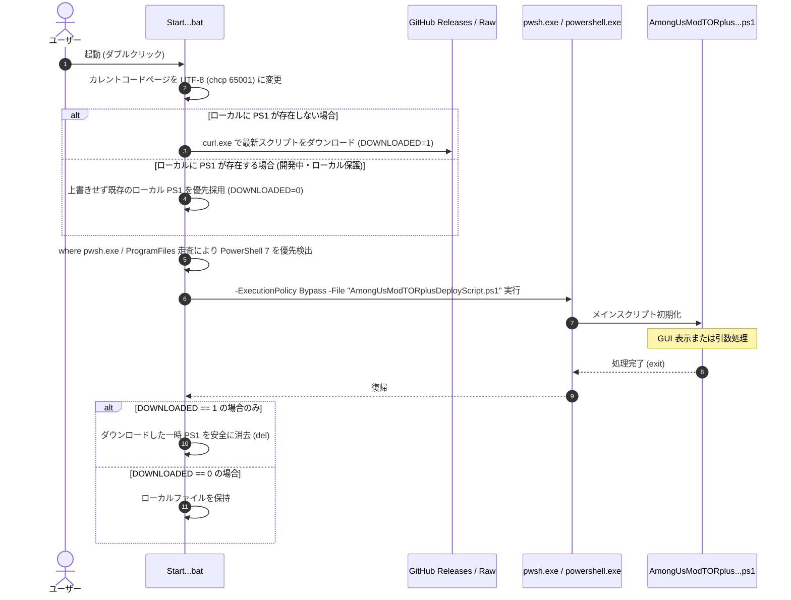
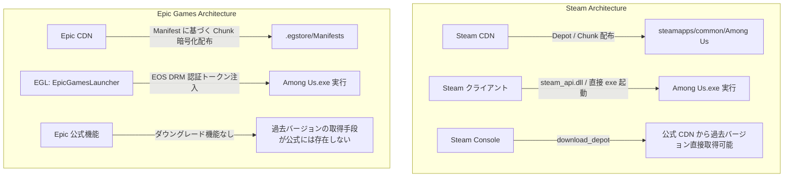
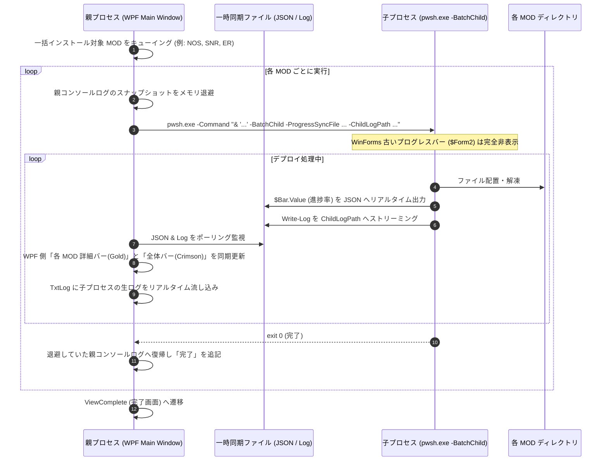

# Among Us Mod Auto Deploy Script (AUMADS)
# 超詳細 技術仕様書 & 内部アーキテクチャ解説マニュアル

---

## 1. プロジェクト基本仕様と目的

### 1.1 プロジェクトの背景と解決する課題
『Among Us』は Unity エンジン（IL2CPP / Mono）で開発されたマルチプレイヤーゲームであり、世界中のコミュニティによって多数の大型 MOD（Nebula on the Ship, SuperNewRoles, ExtremeRoles, TownOfHost 等）が開発されています。
しかし、一般的なユーザーが Among Us に MOD を導入・運用する際には、以下のような重大な技術的障壁が存在していました：

1. **バニラ（公式本体）フォルダの汚染**:
   - ゲーム本体ディレクトリに直接 MOD ファイルや BepInEx を上書きしてしまうと、別の MOD を遊びたいときや、公式アップデートが配信された際にファイルが混ざり合い、ゲームが起動しなくなる。
2. **MOD 間での競合・複数 MOD の共存不可**:
   - 各 MOD は異なるバージョンの BepInEx やアセンブリ、プラグイン DLL を使用するため、1つのインストールフォルダで共存させることができない。
3. **ゲーム本体のバージョン不一致と「ダウングレード」の必要性**:
   - MOD 開発はボランティアで行われることが多く、Among Us 公式の最新アップデートに対して MOD 側の追従が遅れるケースが多発する。その場合、ユーザーはゲーム本体を「1つ前のバージョン」や「特定の日付のバージョン」にダウングレードしなければならない。
4. **プラットフォーム（Steam / Epic Games）による極端な仕様差**:
   - Steam 版は比較的オープンでファイルの直接配置や旧デポダウンロードが可能だが、Epic Games 版は EOS（Epic Online Services）DRM による厳格な認証があり、単に本体をコピーして実行しても認証エラーで即座にクラッシュする。さらに Epic 公式ランチャーにはダウングレード機能が一切存在しない。
5. **Unity IL2CPP 初回起動の重さと CPU 親和性問題**:
   - 近年の Among Us は IL2CPP ビルドとなっており、初回起動時に BepInEx が C++ ネイティブバイナリから C# アセンブリをダンプ・生成（Unstripping / Assembly Generation）するため、起動に数分かかる。また、最新の Intel 第12世代以降の異種コア（Pコア/Eコア）や AMD 高コア環境において、Unity 内部の特定スレッドが暴走しゲームがスタッター（カクつき）を起こす問題がある。

本プロジェクト（AUMADS: Among Us Mod Auto Deploy Script）は、これらすべての複雑な技術課題を **完全自動化** し、バニラ環境を 100% 無傷に保ちながら、ワンクリックで最新または安定した MOD 環境を隔離ディレクトリに展開・更新・起動可能にすることを目的として開発されています。

---

### 1.2 サポート環境と対応プラットフォーム

| 項目 | 要件 / 仕様 |
| :--- | :--- |
| **対応 OS** | Windows 10 (x64) / Windows 11 (x64) |
| **実行基盤** | PowerShell 7 (pwsh.exe 推奨) または Windows PowerShell 5.1 (BOM付き UTF-8 必須) |
| **必要権限** | 管理者権限（Administrator）※必要に応じて自動昇格プロンプトを発火 |
| **対応プラットフォーム** | 1. **Steam 版** (AppID: `945360`, DepotID: `945361`)<br>2. **Epic Games Store 版** (AppID: `963137e4c29d4c79a81323b8fab03a40`) |
| **依存外部ツール** | `curl.exe`, `7-Zip` (PowerShell モジュール内包), `legendary.exe` (Epic 版制御 CLI), `aria2c` (任意高速ダウンローダー) |

---

### 1.3 サポート MOD 一覧とバージョン互換性マトリクス

本スクリプトでは、Among Us 本体バージョン（v19: `2026.9.29`、v18: `2026.8.18`、v17: `2026.6.5` 等）ごとに各 MOD の最小動作保証バージョン（Minimum Version）を厳密にマッピングしています。

| MOD 識別子 | MOD 正式名称 | 開発元 / リポジトリ | v19 最小対応バージョン | 備考 |
| :--- | :--- | :--- | :--- | :--- |
| **NOS** | Nebula on the Ship | [Dolly1016/Nebula](https://github.com/Dolly1016/Nebula) | `110` | BepInEx 6 IL2CPP ベース。アドオン自動取得機能あり。 |
| **SNR** | SuperNewRoles | [SuperNewRoles/SuperNewRoles](https://github.com/SuperNewRoles/SuperNewRoles) | `3.3.0.0` | プラットフォーム別 ZIP (`_Steam.zip`, `_Epic.zip`) 配布。 |
| **ER** | ExtremeRoles | [yukieiji/ExtremeRoles](https://github.com/yukieiji/ExtremeRoles) | `v2026.9.30.0` | BepInEx 6 IL2CPP。最新アセンブリ対応。 |
| **ER+ES** | ExtremeRoles + ExtremeSkins | 同上 ＋ [ExtremeSkins](https://github.com/yukieiji/ExtremeSkins) | `v2026.9.30.0` | ER に加えて追加スキンパッケージを一括デプロイ。 |
| **SRA** | StellarRolesAU | [ﺐ/StellarRolesAU](https://github.com/stellar-roles-au/StellarRolesAU) | `v2026.10.8` | 多彩な役職を追加する大型 MOD。 |
| **LM** | LasMonjas | [All-Of-Us-Mods/LasMonjas](https://github.com/All-Of-Us-Mods/LasMonjas) | `4.0.1` | 海外製人気大型 MOD。 |
| **TOH** | TownOfHost | [tukasa0001/TownOfHost](https://github.com/tukasa0001/TownOfHost) | `v5.1.13` | ホストのみ導入で全員が参加可能なホスト型 MOD。 |

> **非推奨・サポート終了 MOD**:
> `TOR` (TheOtherRoles), `TOU-R` (TownOfUs-R), `TOY` (TheOtherYouth), `TOR GMH`, `AMS`, `TOR MR`, `RHR` は、開発終了または長期更新停止に伴い、スクリプト内で `MinimumVersion = "NONE"` に設定され、UI からは非表示となっています。

---

### 1.4 スクリプト全体ファイル構成と役割分担

```
AmongUs-Mod-Auto-Deploy-Script/
├── AmongUsModTORplusDeployScript.ps1  # 【メイン】デプロイエンジン & WPF UI 本体（約6,000行）
├── StartAmongUsModTORplusDeployScript.bat # 【起動用】GitHub からの自動更新・pwsh 昇格ラッパー
├── AmongusCleanInstall_Steam.ps1     # 【Steam用】公式バニラ自動修復・クリーンインストールスクリプト
├── AmongusCleanInstall_Epic.ps1      # 【Epic用】Legendary を用いたバニラクリーンインストールスクリプト
├── gmhtechsupport.ps1                # 【診断ツール】ログ収集、BepInEx エラー診断、サポートファイル生成
├── AutoDeployTestEnv/                # 【CI/CD】VMware vCenter/ESXi 自動検証テストスイート
│   └── scripts/
│       ├── Run-AutoDeployTest.ps1    # Steam/Epic × Win10/Win11 自動総合テストランナー
│       ├── Update-TestVMBase.ps1     # 月次 VM ベース自動更新 & スナップショット作成スクリプト
│       ├── Register-MonthlyMaintenanceTask.ps1 # タスクスケジューラ登録
│       └── Test-VCenterConnection.ps1# vCenter 接続・VM 健全性検査
├── manual/                           # 【本マニュアル】
│   └── manual.md
├── docs/                             # 【内部設計・運用記録】
│   ├── memory.md                     # 長期記憶・設計原則・プラットフォーム知見
│   ├── memo.md                       # 一時外部記憶・作業進捗
│   ├── testflow.md                   # 自動テスト仕様
│   └── remediation_history.md        # 変更・改修履歴
└── original/                         # 【安全用退避】リファクタリング前バックアップ
```

---

## 2. 実行アーキテクチャと制御フロー

### 2.1 起動シーケンス (BAT ➔ PowerShell 7 / 5.1 昇格)

ユーザーがダブルクリックするのは [`StartAmongUsModTORplusDeployScript.bat`](file:///d:/github/AmongUs-Mod-Auto-Deploy-Script/StartAmongUsModTORplusDeployScript.bat) です。このバッチファイルは単なるショートカットではなく、以下の高度な安全機構を備えています：



---

### 2.2 パラメータ仕様と実行モード

[`AmongUsModTORplusDeployScript.ps1`](file:///d:/github/AmongUs-Mod-Auto-Deploy-Script/AmongUsModTORplusDeployScript.ps1#L1-L9) の先頭パラメータブロック：

```powershell
Param(
    $Args1,                  # 非対話実行用 MOD 番号 (1: NOS, 2: SNR, 3: ER, 4: ER+ES, 5: SRA, 6: LM, 7: TOH, ALL: 一括)
    [switch]$DebugMode,       # デバッグログ出力スイッチ
    [string]$DeployPlatform,  # プラットフォーム明示指定 ("Steam" または "Epic")
    [switch]$BatchChild,      # 一括インストール時の子プロセス実行フラグ
    [string]$ProgressSyncFile,# 子プロセスから親プロセスへのリアルタイム進捗通知 JSON パス
    [string]$ChildLogPath,    # 子プロセス専用のログ出力先パス
    [int]$TargetLatestFlag = 0# 親プロセスから伝搬される本体バージョンフラグ (0: 自動, 1: 最新, 2: 1つ前)
)
```

1. **通常対話モード (`$Args1` なし)**:
   - WPF のシングルウィンドウ GUI を起動。ユーザーがプラットフォーム、インストール先、対象 MOD、本体バージョン、既存フォルダ処理、ショートカット作成有無を自由に選択。
2. **非対話 CLI モード (`-Args1 <MOD番号>` または位置引数)**:
   - GUI を一切表示せず、バックグラウンドまたは自動テストから直接指定された MOD をデプロイ。
3. **一括インストール・子プロセスモード (`-BatchChild -ProgressSyncFile <path>` 等)**:
   - 親プロセスが各 MOD を展開する際、環境のクリーン性を保証するために独立したプロセスとして自身を再帰呼び出しするモード。

---

### 2.3 WPF/XAML シングルウィンドウ GUI アーキテクチャ

v3.0.0 では、従来の古めかしい WinForms（複数の小さなダイアログやプログレスウィンドウが次々とポップアップする構成）を完全に撤廃し、**WPF / XAML によるシングルウィンドウ（Single Window）アーキテクチャ** に統合されました。

- **画面遷移の仮想化**:
  - ウィンドウ自体は破棄・再生成せず、単一の `Window` 内に 3 つのグリッド（View）をスタック配置し、`Visibility`（`Visible` / `Collapsed`）を切り替えることでシームレスな画面遷移を実現：
    1. **`ViewConfig` (設定画面)**: プラットフォーム選択、MOD 選択カード、バージョン選択、ショートカット設定。
    2. **`ViewProgress` (進行状況画面)**: 全体進捗バー（Toppat Crimson）、各 MOD 詳細進捗バー（Toppat Gold）、リアルタイムコンソールログ。
    3. **`ViewComplete` (完了画面)**: デプロイ結果サマリー、ショートカット案内、ワンクリックゲーム起動ボタン。

---

### 2.4 Dispatcher Pump による非同期風 UI 描画とスコープ温存

PowerShell で WPF を扱う際の最大の難所は、**マルチスレッド化すると PowerShell 本体の変数スコープが分断され、既存の膨大な手続き型デプロイロジック（約4,000行）が破壊される（デグレする）** 点にあります。
AUMADS では、メインスレッド上でデプロイエンジンを実行しつつ、UI を一切フリーズさせないために **WPF Dispatcher Pump パターン** を採用しています：

```powershell
# UI の強制再描画（Dispatcher Pump）
[System.Windows.Threading.Dispatcher]::CurrentDispatcher.Invoke([Action]{}, [System.Windows.Threading.DispatcherPriority]::Render)
```

`Write-Log` 関数が呼び出されるたび、内部でログ文字列が WPF の `TxtLog`（RichTextBox / TextBox）へ追記され、即座に上記の Dispatcher Pump が発火して画面が描画更新されます。これにより、バックグラウンドスレッドを立ち上げることなく、メインスレッドのグローバル変数をすべて温存したまま、滑らかなリアルタイム進行状況表示を実現しています。

---

### 2.5 OS テーマ連動 (Dark/Light) と Airship カラーパレット設計

GUI のビジュアルテーマは、Among Us の屈指の人気マップである飛行船ステージ **「The Airship」（Toppat Clan 飛行船）** をモチーフに策定されています。

- **Toppat Crimson (深紅)**: `#DC2626` / `#C81D25`（主要アクセント・全体プログレスバー）
- **Toppat Gold (ゴールド)**: `#F59E0B` / `#D97706`（個別進捗バー・強調テキスト・重要ボタン）
- **Deep Burgundy (暗赤色)**: `#450A0A` / `#7F1D1D`（ボーダー・ヘッダー背景）

さらに、Windows の個人設定レジストリ：
`HKCU:\SOFTWARE\Microsoft\Windows\CurrentVersion\Themes\Personalize\AppsUseLightTheme`
を自動監視し、OS がダークモードの場合は洗練されたダークスレート基調（`#0F172A`）、ライトモードの場合は上質なオフホワイト基調（`#F8FAFC`）へ、XAML 内の `DynamicResource` ブラシを動的に切り替えます。

---

## 3. 【深掘り】Epic Games 版の内部アーキテクチャと Manifest バージョン管理

本プロジェクトにおいて技術的に最も高度で、他ツールには真似のできない独自ノウハウが集約されているのが **「Epic Games 版 Among Us の制御・ダウングレード・EOS 認証連携」** です。

---

### 3.1 Epic Games Store (EGS) / EOS (Epic Online Services) の配信・認証アーキテクチャ

Steam と Epic Games Store では、ゲームファイルの配布および起動認証の仕組みが根本から異なります。



Epic Games 版の Among Us は、起動時に **EOS（Epic Online Services）SDK** を介して Epic Games Launcher（EGL）と通信し、有効な OAuth2 認証トークンやライセンスチケットを照合します。
もし EGL を介さずに MOD フォルダ内の `Among Us.exe` を直接ダブルクリックすると、EOS SDK が初期化に失敗し、タイトル画面にすら到達せずにサイレントクラッシュまたは「EOS Auth Error」で終了します。

---

### 3.2 なぜ Epic 版でダウングレードや MOD 起動が困難なのか

1. **ファイルの分散と暗号化チャンク**:
   - Epic はゲーム全体を 1 つのファイルとして持っているのではなく、数十 KB〜数 MB 単位の「チャンク（Chunk）」としてハッシュ管理しています。
2. **公式クライアントの制限**:
   - Epic Games Launcher は常に最新バージョンへの自動更新（強制アップデート）を前提としており、過去バージョンの配布 API を公式 UI から隠蔽しています。
3. **パスの揺らぎ（スペースの有無）**:
   - 公式インストーラーのバージョンやインストール時の指定によって、フォルダ名が `C:\Program Files\Epic Games\Among Us`（スペースあり）になる場合と `C:\Program Files\Epic Games\AmongUs`（スペースなし）になる場合が混在します。

---

### 3.3 `.egstore` と Manifest (`.manifest`) の構造・動作原理

Epic Games でゲームをインストールすると、インストールフォルダ直下に隠しフォルダ **`.egstore`** が作成されます。

```
C:\Program Files\Epic Games\Among Us\
├── .egstore/
│   ├── 963137e4c29d4c79a81323b8fab03a40.manifest  # ★AppID マニフェストファイル
│   ├── bps/                                         # ビルドパッチメタデータ
│   └── Pending/
├── Among Us_Data/
├── Among Us.exe
└── UnityPlayer.dll
```

#### Manifest ファイル (`.manifest`) の正体
この `.manifest` ファイル（内部構造はバイナリまたは JSON 形式）には、**そのバージョンを構成する全ファイルのパス、サイズ、SHA-1/SHA-256 ハッシュ値、および Epic CDN 上のチャンク識別子（Chunk GUID）の完全なインデックス** が記録されています。
Epic CDN にチャンクデータが存在していても、**どのチャンクをどの順序で組み立てれば Among Us の特定バージョンになるかを示した「設計図」がこの `.manifest` ファイル** です。
つまり、**.manifest ファイルさえ手元にあれば、Epic 公式 CDN からその過去バージョンをバイト単位で正確に復元できる** のです。

---

### 3.4 代替 CLI クライアント「Legendary」の統合と認証引き継ぎ

AUMADS では、Epic Games Launcher の CLI 代替ツールとして極めて優秀なオープンソースツール **`legendary.exe`** を完全に組み込んで制御しています。

- **自動インストール**:
  - システムに `legendary` が存在しない場合、[`AmongusCleanInstall_Epic.ps1`](file:///d:/github/AmongUs-Mod-Auto-Deploy-Script/AmongusCleanInstall_Epic.ps1#L240-L250) が Chocolatey 経由で自動インストール（`choco install legendary -y`）。
- **認証のシームレスなインポート**:
  - `legendary auth --import` コマンドを実行することで、Windows 上ですでにログインされている公式 Epic Games Launcher の認証資格情報（Cookie / OAuth リフレッシュトークン）を自動的に Legendary 側へインポートします。ユーザーにメールアドレスやパスワードを再入力させる必要は一切ありません。

---

### 3.5 Manifest ファイルの自動バックアップ処理 (`BackUpAU`)

AUMADS は、ユーザーがスクリプトを実行するたびに、現在公式ランチャーでインストールされている最新バージョンのマニフェストファイルを自動検知して恒久保存します。

[`AmongUsModTORplusDeployScript.ps1`](file:///d:/github/AmongUs-Mod-Auto-Deploy-Script/AmongUsModTORplusDeployScript.ps1#L556-L567) のバックアップロジック：

```powershell
# Manifest Backup
if ($platform -eq "epic") {
    if (!(Test-Path "$aupathb\epic_manifest")) {
        New-Item "$aupathb\epic_manifest" -Type Directory
    }
    if (Test-Path "$aupatho\.egstore") {
        if (!(Test-Path "$aupathb\$amver.manifest")) {
            $egmani = Get-ChildItem -path "$aupatho\.egstore\*.manifest"
            Copy-Item "$aupatho\.egstore\$($egmani[0].Name)" "$aupathb\epic_manifest\v$amver.manifest"
        }
    }
}
```

- `$aupathb`（バックアップディレクトリ: 通常は `.../AmongUsBackup`）配下に `epic_manifest` フォルダを作成。
- 現在のバニラバージョン（例: `v2026.9.29`）を冠したファイル名（`v2026.9.29.manifest`）としてコピー退避。
- これにより、将来公式が勝手にアップデートを行っても、**自環境で遊んでいた過去バージョンの設計図（マニフェスト）が半永久的に資産として蓄積** されます。

---

### 3.6 過去バージョン (ダウングレード) 復元の完全シーケンス

MOD が要求するバージョンが最新本体より古く、ダウングレードが必要な場合（`$oldtype = $true` かつ `$prevchk = $true`）、以下の精密な手順が自動実行されます。

#### (1) Manifest ファイルの探索と手動指定ダイアログ
まず `$aupathb\epic_manifest` 内に要求バージョン（例: `$prever = "2026.8.18"`）を含むマニフェストがあるか探索します。
もし見つからない場合（新規 PC や初導入時）、スクリプトは `OpenFileDialog` をポップアップし、ユーザーに Discord や有志から入手した過去の `.manifest` ファイルの指定を求めます：

```powershell
$dialog = New-Object System.Windows.Forms.OpenFileDialog
$dialog.Filter = $(Get-Translate("manifest ファイル(*.manifest)|*.manifest"))
$dialog.Title = $(Get-Translate("Manifestファイルを選択してください"))
```

指定されたファイルは自動的に `$aupathb\epic_manifest\` 配下に正規化されて登録されます。

#### (2) Legendary を用いたファイル復元コマンド詳解
マニフェストが確保されると、[`AmongUsModTORplusDeployScript.ps1`](file:///d:/github/AmongUs-Mod-Auto-Deploy-Script/AmongUsModTORplusDeployScript.ps1#L717-L728) は以下のシーケンスを実行します：

```powershell
# 1. 認証トークンの最新化
legendary.exe auth --delete
Start-Sleep -Seconds 3
legendary.exe auth --import

# 2. 現在のインストール状態の登録解除
legendary.exe -y import 'Among Us' "$aupatho"
legendary.exe uninstall "Among Us" --keep-files -y

# 3. 復元用ワークスペースの準備
Copy-Item $aupatho "$aupathb\AmongUs" -Recurse
legendary.exe -y import 'Among Us' "$aupathb\AmongUs"
Start-Sleep -Seconds 1
Remove-item "$aupathb\AmongUs" -Recurse -Force

# 4. 指定マニフェストによる過去バージョンの強制ダウンロード・構築
legendary.exe install "Among Us" --old-manifest "$epicmanifestfile" --disable-patching --enable-reordering --repair -y
```

各オプションの技術的意義：
- **`--old-manifest "$epicmanifestfile"`**:
  - Legendary に対して、Epic サーバーの最新メタデータを無視し、渡されたマニフェストファイルに記載されたチャンク構成に従ってダウンロードするよう命令します。
- **`--disable-patching`**:
  - 通常の差分アップデートアルゴリズムを無効化します。差分パッチングを有効にしていると、最新版との差分計算に失敗してファイルが破損するため、完全な状態のチャンクをゼロから復元させます。
- **`--enable-reordering`**:
  - CDN からのチャンク取得順序を最適化し、ディスク I/O とネットワーク帯域の並列効率を最大化します。
- **`--repair`**:
  - 既存の不完全なファイルを検査し、マニフェストとハッシュが一致しないファイルを強制的に再ダウンロード・修復します。

---

### 3.7 Unity バイナリ (`globalgamemanagers`) からの正規表現バージョン判定

ダウンロードが完了した後、スクリプトは Legendary の終了コードだけを鵜呑みにせず、**復元されたゲームファイル自体のバイナリヘッダーを直接解析してバージョン検証** を行います：

```powershell
$ptt = [System.IO.File]::ReadAllBytes("$aupathb\AmongUs\Among Us_Data\globalgamemanagers")
$ptt2 = [System.Text.Encoding]::UTF8.GetString($ptt)
$ptt3 = [regex]::Matches($ptt2, "(19|20)[0-9]{2}[- /.]([1-9]|0[1-9]|1[012])[- /.](0[1-9]|[12][0-9]|3[01])")
if ($null -eq $ptt3[1]) {
    $pmver = $ptt3[0].Value
} else {
    $pmver = $ptt3[1].Value
}
```

- **なぜ `globalgamemanagers` なのか？**:
  - Among Us のビルドバージョン文字列（例: `2026.8.18`）は、Unity のグローバルアセットファイル `globalgamemanagers` の内部にプレーンテキスト（UTF-8）として埋め込まれています。
- **正規表現 `(19|20)[0-9]{2}[- /.]([1-9]|0[1-9]|1[012])[- /.](0[1-9]|[12][0-9]|3[01])`**:
  - 年月日形式のバージョン文字列をバイナリダンプから直接抽出。
- **判定結果**:
  - 抽出された `$pmver` が目的の `$prever` と完全に一致した場合のみダウンロード成功とみなし、7-Zip でアーカイブ化（`Among Us-$datest-v$prever.zip`）。
  - もしユーザーが間違ったマニフェストを指定していた場合は即座に検知し、不正なファイルの拡散を防ぎます。

---

### 3.8 Epic 版 MOD 起動のトリック: EGL 同期と EOS 認証バイパス

Epic 版で最も鮮やかな解決策が、**デスクトップショートカットから起動されるバッチスクリプトの仕組み** です。
前述の通り、MOD フォルダの `Among Us.exe` を直接叩くことはできません。かといって公式ランチャー（EGL）から起動すると、バニラフォルダの本体が起動してしまいます。

そこで AUMADS は、起動時に **Legendary の「EGL メタデータ同期機能」** を利用して、**「今から起動するこの MOD フォルダこそが、公式の Among Us である」と一時的に偽装・登録** します。

生成される起動スクリプト（[`amongusrun_<MOD>.ps1`](file:///d:/github/AmongUs-Mod-Auto-Deploy-Script/AmongUsModTORplusDeployScript.ps1#L5041-L5060)）の実行内容：

```powershell
# 1. 最新の認証をインポート
legendary auth --import

# 2. 現在の追跡を解除 (実ファイルは保持)
legendary -y uninstall Among Us --keep-files

# 3. 起動したい MOD フォルダを公式の「Among Us」としてインポート
legendary -y import 'Among Us' 'C:\Program Files\Epic Games\AmongUs NOS Mod'

# 4. ★最重要★ Epic Games Launcher 側のデータベース (.item ファイル等) と同期
legendary -y egl-sync

# 5. 正当な EOS DRM トークンを発行させて起動！
legendary launch Among Us

# 6. Unity スタッター対策 (CPU アフィニティを CPU 0 に固定)
Start-Sleep -Seconds 30
Get-Process -Name 'Among Us' | ForEach-Object { $_.ProcessorAffinity = 1 }
```

このシーケンスにより：
1. Epic Games 公式ランチャー側も「現在インストールされている Among Us はこの MOD フォルダである」と認識する。
2. `legendary launch` が EGL から正式なセッショントークンを取得し、環境変数に注入してゲームを起動する。
3. EOS 認証を完全にパスし、オンラインロビーへの接続やアカウントログインが 100% 正常に機能する！

---

### 3.9 Epic 版で発生した歴史的障害と多重防御ガード

過去の自動テストおよび実機運用において特定・解決された重要なエッジケース：

1. **フォルダ名のスペース揺らぎ (`Among Us` vs `AmongUs`)**:
   - Legendary は `--base-path` 指定時にゲーム名にスペースが含まれると `C:\Program Files\Epic Games\Among Us` を作成するが、古い EGL や手動インストールでは `AmongUs`（スペースなし）になるケースがあった。
   - スクリプト側で両方のパスを常時監視し、存在する側へ自動フォールバックするよう修正済み。
2. **未インストール環境でのルート直下 (`C:\AmongUs`) 誤配置バグ**:
   - ゲーム未インストール状態で `legendary info AmongUs` を実行すると `Install path:` の行が存在せず、親ディレクトリを取得する `Split-Path` の結果が空文字 `""` になる。
   - これにより、`$spath = "$epicbase\AmongUs"` がドライブレターなしの `"\AmongUs"`（ルート直下）と解釈され、親パスが `\`（C ドライブ直下）と判定されて `C:\AmongUs` に新規インストールされてしまう障害が発生。
   - **対策**: 親ディレクトリが `\` または空文字の場合は即座に代入を拒絶し、安全な既定値 `C:\Program Files\Epic Games` を強制代入する多重防御ガードを実装。
3. **`Start-Transcript` 排他ロック例外**:
   - スクリプトがトランスクリプトを記録している際、`Write-Log` が `Out-File` や `Set-Content` を呼ぶと、Windows のファイル排他制御に引っかかりスクリプトがクラッシュしていた。
   - `[System.IO.File]::AppendAllText($LogFileName, ...)` に置換し、完全非ロックでのログ追記を保証。

---

## 4. Steam 版の内部アーキテクチャとクリーンインストール・デポ取得

### 4.1 Steam クライアント連携とインストールパス探索

Steam 版の場合、スクリプトは以下の順序で Steam の実行ファイルおよびインストールフォルダを探索します：
1. レジストリキー: `HKCU:\Software\Valve\Steam\SteamExe`
2. 実行中プロセス: `Get-Process steam` のメインモジュールパス
3. デフォルトパス: `C:\Program Files (x86)\Steam\Steam.exe`

バニラゲームフォルダは `steamapps\common\Among Us`、バックアップフォルダは `steamapps\common\Among Us Backup` に自動構成されます。

---

### 4.2 Steam コンソール機能による旧バージョンデポ直接ダウンロード (`download_depot`)

Steam には、公式クライアント自体に特定デポ（Depot）の特定マニフェスト ID をダウンロードする隠しコンソールコマンドが存在します。
AUMADS はこれを利用して、Steam 版の過去バージョンを直接ダウンロードします：

[`AmongUsModTORplusDeployScript.ps1`](file:///d:/github/AmongUs-Mod-Auto-Deploy-Script/AmongUsModTORplusDeployScript.ps1#L636-L644)：

```powershell
# Among Us AppID: 945360, Main DepotID: 945361
Start-Process $steampth -argument "+download_depot 945360 945361 $prevtargetid"

# ダウンロード中は Steam ウィンドウを最小化してユーザーの邪魔をしない
$window = [System.Windows.Automation.AutomationElement]::FromHandle($hwnd)
$windowPattern = $window.GetCurrentPattern([System.Windows.Automation.WindowPattern]::Pattern)
$windowPattern.SetWindowVisualState([System.Windows.Automation.WindowVisualState]::Minimized)
```

ダウンロード先は `Steam\steamapps\content\app_945360\depot_945361` となり、ダウンロード完了後にスクリプトが自動回収して zip 圧縮保存し、一時フォルダをクリーンアップします。

---

### 4.3 Steam クリーンインストールとダウンロード保留 (StateFlags=6) の自動復旧

Steam 版の自動修復・クリーンインストール時、最大の技術的難所となったのが **「Steam の自動更新スケジュール保留（`StateFlags = 6`）」** です。
Steam はバックグラウンドでの帯域節約のため、ファイルの整合性確認を行ってもダウンロードを即座に開始せず、「本日の XX:XX にスケジュール済み」として待機状態にしてしまうことがあります。

AUMADS は、**Steam カスタムプロトコル URI** を直接コールすることでこの保留を即座に吹き飛ばし、最優先ダウンロードキューを強制発火させます：

[`AmongusCleanInstall_Steam.ps1`](file:///d:/github/AmongUs-Mod-Auto-Deploy-Script/AmongusCleanInstall_Steam.ps1#L282-L289)：

```powershell
# Steam プロトコル URI による即時検証・最優先ダウンロード強制発火
Start-Process "steam://validate/945360"
Start-Process $steampth -argument "+app_start_validation 945360"
```

---

### 4.4 `Wait-ForSteamAmongUsInstall` と VDF パーサー (`ConvertFrom-VDF`) によるリアルタイム監視

ダウンロード中、スクリプトは `C:\Program Files (x86)\Steam\steamapps\appmanifest_945360.acf` をリアルタイム監視します。
このファイルは Valve 独自の **KeyValues / VDF フォーマット** で記述されているため、スクリプト内に内蔵された [`ConvertFrom-VDF`](file:///d:/github/AmongUs-Mod-Auto-Deploy-Script/AmongUsModTORplusDeployScript.ps1#L780-L882) 関数によって PowerShell オブジェクトに変換されます：

```powershell
# 進捗率の算出
$pct = [math]::Round(($bytesDl / $bytesTotal) * 100, 1)
Write-Log "Steam ダウンロード進捗: $pct% ($dlMB MB / $totalMB MB)"
```

さらに、以下の **二重保険フェイルセーフ** が組み込まれています：
- **45秒ストール監視**: 45秒間進捗バイト数が一切変化しない場合、`steam://validate/945360` を再送信。
- **90秒ストール監視**: 90秒間完全にダウンロードが停止した場合、Steam プロセスを強制終了・再起動してダウンロードを再開。

---

## 5. MOD デプロイエンジンと BepInEx / IL2CPP の深層

### 5.1 バニラ完全分離コピーと隔離ディレクトリ展開

MOD のインストール時、AUMADS はバニラフォルダには **1バイトも書き込みを行いません**。
バニラフォルダ（またはバックアップ zip）から、独立した隔離ディレクトリ（例: `Among Us NOS Mod`）へ Robocopy または 7-Zip を用いて丸ごと高速複製します。
これにより、複数の MOD（NOS, SNR, ER 等）をそれぞれの独立フォルダに同居させることができ、公式アップデートが入っても既存の MOD 環境は完全に保護されます。

---

### 5.2 GitHub API レート制限 (403 Rate Limit) 回避と直接 URL フォールバック

MOD 本体や BepInEx の最新リリースを取得する際、GitHub REST API (`api.github.com/repos/.../releases`) を呼び出します。
しかし、認証トークンなしの API 呼び出しは **「1 IP あたり 60 回 / 時間」** という極めて厳しいレート制限が存在します。特に全 7 Mod 一括テストなどを実行すると即座に `403 Rate limit exceeded` が発生します。

AUMADS では以下の多層防御を施しています：
1. **子プロセス実行時のプレフェッチ抑止**:
   - 一括インストール時、子プロセス側での無駄な全 MOD API 取得を完全スキップ。
2. **静的 Releases URL への自動フォールバック**:
   - API が 403 を返した場合でもスクリプトを中断させず、定義済みの最小動作バージョン（`$script:aumin`）を用いて、公式 Releases の直接ダウンロード URL（`github.com/.../releases/download/...` ※こちらは API レート制限対象外）を動的に組み立ててダウンロードを完走させます。

---

### 5.3 BepInEx 6 (IL2CPP) の初期化・アセンブリ生成待機 (Unstripping / Generating Assemblies)

近年の Among Us MOD はほぼすべて **BepInEx 6 (IL2CPP)** を基盤としています。
IL2CPP 版ゲームでは、初回起動時に BepInEx がゲームのネイティブバイナリ（`GameAssembly.dll`）から Unity の型情報や C# メタデータを抽出し、`BepInEx/interop/` 配下にダミーアセンブリ（Interop Assemblies）を自動生成します。

- **所要時間**:
  - 初回起動時はこの生成処理に **約 80〜120 秒** を要します。
- **排他ロック問題の解消**:
  - ゲーム起動中にスクリプトが BepInEx の `LogOutput.log` を `[System.IO.File]::ReadAllText` で読もうとすると、BepInEx の書き込みロックと衝突して例外が発生します。
  - スクリプト側で `[System.IO.FileShare]::ReadWrite` を指定した `FileStream` を用いることで、ゲーム動作中であっても安全にログを監視可能にしました。
- **起動検知フラグ**:
  - ログ内に `Chainloader ready` または `Chainloader startup complete` が記録された時点で、MOD のロードが 100% 完了したと判定します。

---

### 5.4 CPU Affinity (プロセッサ親和性) 制御による Unity スタッター防止

第12世代以降の Intel Core プロセッサ（Alder Lake / Raptor Lake 等）やマルチスレッド CPU において、古い Unity ランタイムが原因でゲームのフレームレートが著しく低下したり、カクつき（スタッター）が発生する問題が広く報告されています。
AUMADS は、MOD 起動時に PowerShell またはショートカット経由でゲームプロセスの **プロセッサ親和性（Processor Affinity）** を自動制御する機能を備えています：

- **CPU 0 単一固定 (`ProcessorAffinity = 1`)**:
  - 最も安定したシングルコア動作を強制し、スレッド競合を解消。
- **CPU 0 & 1 デュアル固定 (`ProcessorAffinity = 3`)**:
  - パフォーマンスと安定性のバランスを確保。

---

### 5.5 特殊 MOD 依存関係 (VOICEVOX, Mini.RegionInstall, NOS Addons)

- **VOICEVOX インストーラー自動スキップ**:
  - ExtremeRoles (ER / ER+ES) はテキスト読み上げ用の VOICEVOX 連携機能を持っていますが、GPU ドライバの判定（`$VideoController.Name`）で null 例外が発生する不具合がありました。また自動テストや一括インストールでインストーラーダイアログが立ち往生しないよう、一括実行時は自動スキップガードを設けています。
- **Mini.RegionInstall**:
  - MOD サーバー（カスタムリージョン）に接続するための設定ファイルを自動生成・注入。

---

## 6. 一括デプロイ (Batch Install) と親プロセス・子プロセス同期モデル

### 6.1 親子プロセス分離アーキテクチャの必然性

全 7 種の MOD をまとめて導入・更新する「一括インストール（Install Selected）」機能において、単一のプロセス内でループを回すと、以下の致命的な問題が発生します：
1. **変数スコープの汚染**: 各 MOD ごとにダウンロード先パス、バージョン変数、アセンブリ情報が上書きされ、後半の MOD で予期せぬ不具合が起きる。
2. **メモリリークとファイルロック**: 前の MOD の解凍処理やリソースがプロセス内に残り、ディスクやメモリを圧迫する。

そのため、AUMADS では **「親プロセスはオーケストレーターに徹し、各 MOD のデプロイは子プロセス（PowerShell 7）を独立起動して任せる」** 完全分離アーキテクチャを採用しています。



---

### 6.2 引数受け渡し仕様

親プロセスから子プロセスを起動する際、PowerShell 7 の CLI パーサーで引数解釈エラー（ExitCode: 64）を起こさないよう、`-Command` 形式を用いて厳密にエスケープされたコマンドラインを構築します：

```powershell
$childArgs = "-NoProfile -ExecutionPolicy Bypass -Command `"& '$scriptPath' '$modArg' -BatchChild -ProgressSyncFile '$syncFile' -ChildLogPath '$childLog' -TargetLatestFlag $latestflag`""
Start-Process $psExe -ArgumentList $childArgs -Wait
```

---

### 6.3 スクリプト自己消去ガードとディスク容量 (Error 112) 最適化

1. **自己消去ガード（必須ガード）**:
   - 単体実行用の機能であるスクリプト末尾の「BAT 自動更新 & PS1 遅延削除 (`del AmongUsModTORplusDeployScript.ps1`)」が、子プロセスの終了時にも発火して親プロセスの足元をすくうバグが存在しました。
   - `if (!$BatchChild -and !$isall)` で厳重にガードし、一括実行中はスクリプトファイルを絶対に消去させません。
2. **ディスク容量枯渇（エラー 112: ERROR_DISK_FULL）の最適化**:
   - 全 7 Mod 一括展開では、各 Mod の本体コピー（1 Mod 約 1.1GB × 7 ＝ 約 7.7GB）に加え、毎回バニラバックアップ zip（約 600MB）が重複生成されると、仮想ディスクが圧迫されます。
   - 一括デプロイ時はバニラバックアップ zip の作成を初回 1 回のみに抑止する制御が入っています。

---

## 7. トラブルシューティング & エラーコードリファレンス

### 7.1 ログファイル一覧と解析手順

不具合が発生した際は、以下のログを確認してください：

| ログ種類 | 配置パス | 内容 |
| :--- | :--- | :--- |
| **メインデプロイログ** | `C:\Temp\AUM_Deploy\AmongUsMod_DeployLog_*.log` | GUI およびメインエンジンの全実行記録 (UTF-8) |
| **一括子プロセスログ** | `C:\Temp\AUM_Deploy\AmongUsMod_DeployLog_Child_*.log` | 各 MOD ごとの詳細インストール・配置ログ |
| **Epic クリーンインストールログ** | `C:\Temp\AUM_Clean\AmongUsClean_InstallLog_*.log` | Legendary の実行・インポート・同期ログ |
| **Steam クリーンインストールログ** | `C:\Temp\AUM_Clean\AmongUsClean_InstallLog_*.log` | Steam ダウンロード進捗・acf パースログ |
| **BepInEx 実行ログ** | `<MODフォルダ>\BepInEx\LogOutput.log` | IL2CPP ロード、プラグイン初期化、エラーログ |
| **Unity エンジンログ** | `%APPDATA%\..\LocalLow\Innersloth\Among Us\Player.log` | ゲーム本体のクラッシュ・グラフィクス例外ログ |

---

### 7.2 よくある障害と対処手順

#### Q1. Epic 版で「EOS Auth Error」または起動直後にゲームが落ちる
- **原因**: MOD フォルダ内の `Among Us.exe` を直接起動しているか、Legendary の EGL 同期が外れている。
- **対処**: スクリプトがデスクトップに生成した `Among Us Mod <MOD名>.lnk`（または `startamongusrun_<MOD>.bat`）から起動してください。

#### Q2. Epic 版で過去の Manifest が見つからないと言われる
- **原因**: バックアップフォルダに目的のバージョンの `.manifest` が存在しない。
- **対処**: 表示されるファイル選択ダイアログで、有志または過去に保存した `.manifest` ファイル（例: `v2026.8.18.manifest`）を指定してください。一度指定すれば次回以降は自動で使用されます。

#### Q3. GitHub API 403 Rate Limit エラーが出る
- **原因**: 短時間に何度も MOD の取得や更新を試行したため、GitHub の IP 制限（1時間最大60リクエスト）に到達した。
- **対処**: AUMADS は自動的に公式 Releases 直接 URL へフォールバックして処理を継続しますが、万一停止した場合は約 1 時間待機して制限解除を待つか、プロキシ/VPN を切り替えてください。

#### Q4. Steam 版でクリーンインストールが「ダウンロード中...」のまま進まない
- **原因**: Steam クライアントがダウンロードをスケジュール保留（StateFlags=6）にしている。
- **対処**: スクリプトが自動的に 45 秒で `steam://validate/945360` を再送し、90 秒で Steam を自動再起動して強制復旧します。そのまま最大 2〜3 分待機してください。

---

*Document Version: 3.0.0 (Build 20261026)*  
*Author: Among Us Mod Auto Deploy Script Project / Antigravity Agent*
