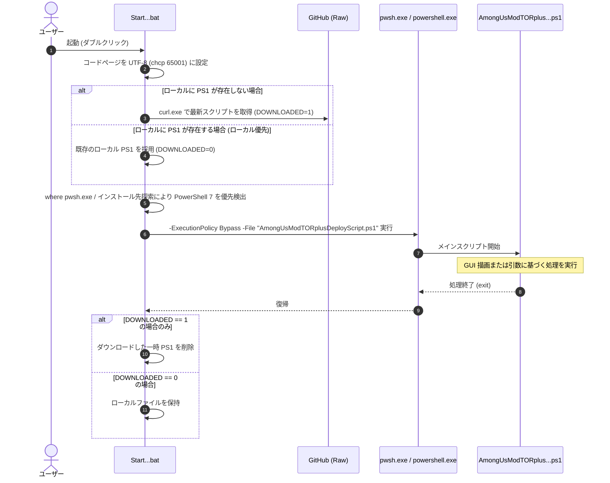
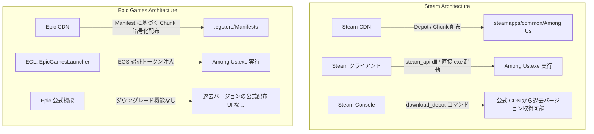
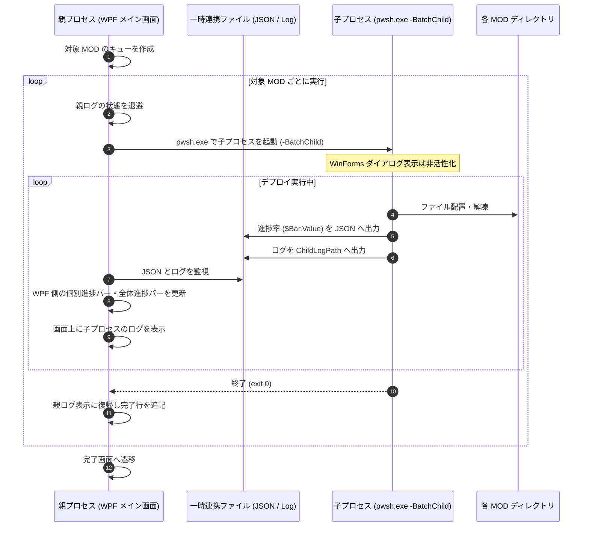

# Among Us Mod Auto Deploy Script (AUMADS)
# 技術仕様書およびアーキテクチャ解説マニュアル

---

## 1. プロジェクト基本仕様と目的

### 1.1 プロジェクトの背景と課題
『Among Us』は Unity エンジン（IL2CPP / Mono）で開発されたマルチプレイヤーゲームであり、コミュニティによって各種 MOD（Nebula on the Ship, SuperNewRoles, ExtremeRoles, TownOfHost 等）が開発されています。
ユーザーが Among Us に MOD を導入・運用する際には、以下のような技術的課題が存在します：

1. **バニラ（公式本体）フォルダの混在**:
   - ゲーム本体ディレクトリに直接 MOD ファイルや BepInEx を導入すると、別の MOD の利用時や公式アップデートの配信時にファイル競合が発生し、正常に起動しなくなる。
2. **複数 MOD の共存**:
   - 各 MOD は異なるバージョンの BepInEx、依存アセンブリ、プラグイン DLL を使用するため、単一のフォルダ内で共存させることが困難である。
3. **ゲーム本体のバージョン不一致とダウングレード**:
   - Among Us 本体のアップデートに対して MOD 側の対応に時間差が生じる場合があり、その期間はゲーム本体を過去のバージョンへダウングレードして運用する必要がある。
4. **プラットフォーム（Steam / Epic Games）による仕様差**:
   - Steam 版はファイルの直接配置やコンソール経由でのデポ取得が可能ですが、Epic Games 版は EOS（Epic Online Services）による認証機構が存在し、実行ファイルの直接起動では認証エラーが発生する。また、Epic Games の公式ランチャーには旧バージョンを取得する機能が用意されていない。
5. **Unity IL2CPP 初回起動の負荷と CPU 親和性**:
   - IL2CPP ビルドの環境では、初回起動時に BepInEx が C++ ネイティブバイナリから C# アセンブリを生成（Unstripping / Assembly Generation）するため、起動完了までに一定の時間を要する。また、近年の異種コア（Pコア/Eコア）や高コア環境において、Unity 内部スレッドの負荷配分に起因するスタッター（表示の乱れ）が発生することがある。

本プロジェクト（AUMADS: Among Us Mod Auto Deploy Script）は、これらの課題をスクリプトによる自動処理で解消し、公式のバニラ環境を変更することなく、独立したディレクトリへ各 MOD 環境を展開・更新・管理することを目的としています。

---

### 1.2 動作環境と対応プラットフォーム

| 項目 | 要件 / 仕様 |
| :--- | :--- |
| **対応 OS** | Windows 10 (x64) / Windows 11 (x64) |
| **実行環境** | PowerShell 7 (pwsh.exe 推奨) または Windows PowerShell 5.1 (BOM付き UTF-8) |
| **権限** | 管理者権限（Administrator）※必要に応じて昇格確認を実施 |
| **対応プラットフォーム** | 1. **Steam 版** (AppID: `945360`, DepotID: `945361`)<br>2. **Epic Games Store 版** (AppID: `963137e4c29d4c79a81323b8fab03a40`) |
| **使用外部ツール** | `curl.exe`, `7-Zip` (スクリプト内包モジュール), `legendary.exe` (Epic 版管理用 CLI), `aria2c` |

---

### 1.3 サポート MOD 一覧とバージョン対応表

本スクリプトでは、Among Us 本体のバージョン（v19: `2026.9.29`、v18: `2026.8.18`、v17: `2026.6.5` 等）ごとに各 MOD の最小動作保証バージョン（Minimum Version）を定義しています。

| MOD 識別子 | MOD 正式名称 | 開発元 / リポジトリ | v19 最小対応バージョン | 備考 |
| :--- | :--- | :--- | :--- | :--- |
| **NOS** | Nebula on the Ship | [Dolly1016/Nebula](https://github.com/Dolly1016/Nebula) | `110` | BepInEx 6 IL2CPP ベース。アドオン自動取得に対応。 |
| **SNR** | SuperNewRoles | [SuperNewRoles/SuperNewRoles](https://github.com/SuperNewRoles/SuperNewRoles) | `3.3.0.0` | プラットフォーム別 ZIP (`_Steam.zip`, `_Epic.zip`) を展開。 |
| **ER** | ExtremeRoles | [yukieiji/ExtremeRoles](https://github.com/yukieiji/ExtremeRoles) | `v2026.9.30.0` | BepInEx 6 IL2CPP。最新アセンブリ対応。 |
| **ER+ES** | ExtremeRoles + ExtremeSkins | 同上 ＋ [ExtremeSkins](https://github.com/yukieiji/ExtremeSkins) | `v2026.9.30.0` | ER に加えて追加スキンパッケージを一括展開。 |
| **SRA** | StellarRolesAU | [ﺐ/StellarRolesAU](https://github.com/stellar-roles-au/StellarRolesAU) | `v2026.10.8` | 多様な役職を追加する大型 MOD。 |
| **LM** | LasMonjas | [All-Of-Us-Mods/LasMonjas](https://github.com/All-Of-Us-Mods/LasMonjas) | `4.0.1` | 海外製大型 MOD。 |
| **TOH** | TownOfHost | [tukasa0001/TownOfHost](https://github.com/tukasa0001/TownOfHost) | `v5.1.13` | ホスト導入型の MOD。 |

> **サポートを終了した MOD**:
> `TOR` (TheOtherRoles), `TOU-R` (TownOfUs-R), `TOY` (TheOtherYouth), `TOR GMH`, `AMS`, `TOR MR`, `RHR` は、開発終了または長期の更新停止に伴い、スクリプト内で `MinimumVersion = "NONE"` に設定され、UI からは非表示となっています。

---

### 1.4 ファイル構成と役割

```
AmongUs-Mod-Auto-Deploy-Script/
├── AmongUsModTORplusDeployScript.ps1  # メインスクリプト（デプロイエンジン & WPF UI、約6,000行）
├── StartAmongUsModTORplusDeployScript.bat # 起動用バッチファイル（スクリプト取得 & pwsh 起動ラッパー）
├── AmongusCleanInstall_Steam.ps1     # Steam 版バニラ修復・クリーンインストール用スクリプト
├── AmongusCleanInstall_Epic.ps1      # Epic Games 版バニラクリーンインストール用スクリプト (Legendary 連携)
├── gmhtechsupport.ps1                # ログ収集・エラー診断用スクリプト
├── AutoDeployTestEnv/                # 自動検証テストスイート (VMware vCenter/ESXi 連携)
│   └── scripts/
│       ├── Run-AutoDeployTest.ps1    # Steam/Epic × Win10/Win11 自動総合テストランナー
│       ├── Update-TestVMBase.ps1     # 月次 VM ベース更新 & スナップショット作成スクリプト
│       ├── Register-MonthlyMaintenanceTask.ps1 # 定期メンテナンス用タスクスケジューラ登録
│       └── Test-VCenterConnection.ps1# vCenter 接続および VM 状態確認スクリプト
├── manual/                           # 本マニュアル格納ディレクトリ
│   └── manual.md
├── docs/                             # 内部設計書・運用ログ
│   ├── memory.md                     # プロジェクトの設計原則および知見の記録
│   ├── memo.md                       # 作業用の一時メモ
│   ├── testflow.md                   # 自動テスト仕様書
│   └── remediation_history.md        # 変更履歴
└── original/                         # リファクタリング前のバックアップ退避領域
```

---

## 2. 実行アーキテクチャと制御フロー

### 2.1 起動シーケンス (BAT ➔ PowerShell 実行)

ユーザーの実行起点となる [`StartAmongUsModTORplusDeployScript.bat`](file:///d:/github/AmongUs-Mod-Auto-Deploy-Script/StartAmongUsModTORplusDeployScript.bat) は、実行環境の準備と PowerShell の呼び出しを行います：



---

### 2.2 パラメータ仕様と実行モード

[`AmongUsModTORplusDeployScript.ps1`](file:///d:/github/AmongUs-Mod-Auto-Deploy-Script/AmongUsModTORplusDeployScript.ps1#L1-L9) のパラメータ定義：

```powershell
Param(
    $Args1,                  # 非対話実行用 MOD 指定 (1: NOS, 2: SNR, 3: ER, 4: ER+ES, 5: SRA, 6: LM, 7: TOH, ALL: 一括)
    [switch]$DebugMode,       # デバッグログ出力
    [string]$DeployPlatform,  # 対象プラットフォームの明示 ("Steam" または "Epic")
    [switch]$BatchChild,      # 一括インストール時の子プロセス実行フラグ
    [string]$ProgressSyncFile,# 子プロセスから親プロセスへの進捗通知用 JSON パス
    [string]$ChildLogPath,    # 子プロセス専用のログ出力先パス
    [int]$TargetLatestFlag = 0# 親プロセスから伝搬される本体バージョン指定 (0: 自動判定, 1: 最新, 2: 1つ前)
)
```

1. **通常対話モード (`$Args1` なし)**:
   - WPF のシングルウィンドウ GUI を起動し、インストール先や対象 MOD、バージョンなどの設定を行ってデプロイを実行します。
2. **非対話 CLI モード (`-Args1 <MOD番号>` または位置引数)**:
   - GUI を表示せず、コマンドライン引数または自動テストから直接指定された MOD をデプロイします。
3. **一括インストール・子プロセスモード (`-BatchChild -ProgressSyncFile <path>` 等)**:
   - 親プロセスが一括デプロイを行う際、環境の独立性を保つために各 MOD の処理を個別プロセスとして呼び出すモードです。

---

### 2.3 WPF/XAML によるシングルウィンドウ構成

v3.0.0 では、従来の WinForms による複数のダイアログ表示を改め、**WPF / XAML によるシングルウィンドウ（Single Window）構成** に移行しました。

- **画面遷移の設計**:
  - ウィンドウを再生成せず、1つの `Window` 内に 3 つのグリッド（View）を配置し、`Visibility`（`Visible` / `Collapsed`）を切り替えることで画面遷移を行います：
    1. **`ViewConfig` (設定画面)**: プラットフォーム選択、MOD 選択、バージョン選択、ショートカット設定。
    2. **`ViewProgress` (進行状況画面)**: 全体進捗バー、個別 MOD 進捗バー、リアルタイムログ。
    3. **`ViewComplete` (完了画面)**: 処理結果サマリー、ショートカット案内、起動ボタン。

---

### 2.4 Dispatcher による UI 描画制御とスコープ維持

PowerShell で WPF を扱う際、バックグラウンドスレッドで処理を行うと変数スコープが分断され、既存の手続き型ロジックとの整合性を維持することが困難になります。
本スクリプトでは、メインスレッド上で処理を実行しながら UI の応答性を維持するため、**Dispatcher Pump パターン** を採用しています：

```powershell
# UI の強制再描画（Dispatcher Pump）
[System.Windows.Threading.Dispatcher]::CurrentDispatcher.Invoke([Action]{}, [System.Windows.Threading.DispatcherPriority]::Render)
```

`Write-Log` 関数が呼び出されるたびに、WPF の `TxtLog`（TextBox）へ文字列が追記され、上記の Dispatcher 処理によって即座に画面の再描画が行われます。これにより、メインスレッドの変数を保持したまま、ログ出力に連動したリアルタイムな画面更新を行っています。

---

### 2.5 OS テーマ連動 (Dark/Light) とカラーパレット

GUI の配色テーマは、Among Us のマップ **「The Airship」** をモチーフに策定されています。

- **Crimson Red (深紅)**: `#DC2626` / `#C81D25`（主要アクセント・全体プログレスバー）
- **Toppat Gold (ゴールド)**: `#F59E0B` / `#D97706`（個別進捗バー・ボタン）
- **Deep Burgundy (暗赤色)**: `#450A0A` / `#7F1D1D`（ボーダー・ヘッダー背景）

また、Windows の個人設定レジストリ：
`HKCU:\SOFTWARE\Microsoft\Windows\CurrentVersion\Themes\Personalize\AppsUseLightTheme`
を参照し、ダークモード時はスレート系カラー（`#0F172A`）、ライトモード時はライトグレー系カラー（`#F8FAFC`）へ、XAML 内の `DynamicResource` ブラシを動的に切り替えます。

---

## 3. Epic Games 版の内部アーキテクチャと Manifest バージョン管理

本章では、Epic Games 版 Among Us における配信仕様、マニフェストによるバージョン管理、および EOS 認証連携の仕組みについて詳述します。

---

### 3.1 Epic Games Store (EGS) / EOS の配信・認証アーキテクチャ

Steam と Epic Games Store では、ゲームファイルの配信および起動認証の仕様が異なります。



Epic Games 版の Among Us は、起動時に **EOS（Epic Online Services）SDK** を介して Epic Games Launcher（EGL）と通信し、ライセンスおよびセッショントークンの検証を行います。
そのため、EGL を経由せずに MOD フォルダ内の `Among Us.exe` を直接起動した場合、EOS SDK の初期化に失敗し、タイトル画面へ進む前にクラッシュするか「EOS Auth Error」となります。

---

### 3.2 Epic 版におけるダウングレードと MOD 起動の課題

1. **チャンクベースの配信管理**:
   - Epic はゲーム全体を単一ファイルとしてではなく、チャンク（分割ブロック）単位でハッシュ管理しています。
2. **公式クライアントの制約**:
   - Epic Games Launcher は常に最新バージョンへの自動更新を基本とし、過去バージョンを任意に選択してインストールする機能を公開していません。
3. **インストールパスの揺らぎ**:
   - インストール時の状況により、フォルダ名が `C:\Program Files\Epic Games\Among Us`（スペースあり）になる場合と `C:\Program Files\Epic Games\AmongUs`（スペースなし）になる場合があります。

---

### 3.3 `.egstore` と Manifest (`.manifest`) の仕様・役割

Epic Games でゲームをインストールすると、インストールフォルダ直下に隠しフォルダ **`.egstore`** が生成されます。

```
C:\Program Files\Epic Games\Among Us\
├── .egstore/
│   ├── 963137e4c29d4c79a81323b8fab03a40.manifest  # AppID マニフェストファイル
│   ├── bps/                                         # ビルドメタデータ
│   └── Pending/
├── Among Us_Data/
├── Among Us.exe
└── UnityPlayer.dll
```

#### Manifest ファイル (`.manifest`) の構造と役割
この `.manifest` ファイルには、**そのバージョンを構成する全ファイルのパス、ファイルサイズ、ハッシュ値、および Epic CDN 上のチャンク識別子（Chunk GUID）の一覧** が記述されています。
Epic CDN にチャンクデータが存在していても、どのチャンクをどのように結合すれば特定バージョンのファイル群になるかを示す情報がこの `.manifest` です。
そのため、該当バージョンの `.manifest` ファイルが存在すれば、Epic 公式 CDN からそのバージョンを構成するファイルをダウンロードして復元することが可能です。

---

### 3.4 CLI クライアント「Legendary」の統合と認証連携

本スクリプトでは、Epic Games の CLI クライアントである **`legendary.exe`** を利用して各種操作を自動化しています。

- **自動セットアップ**:
  - システムに `legendary` が存在しない場合、[`AmongusCleanInstall_Epic.ps1`](file:///d:/github/AmongUs-Mod-Auto-Deploy-Script/AmongusCleanInstall_Epic.ps1#L240-L250) が Chocolatey 経由でインストール（`choco install legendary -y`）を実施します。
- **認証のインポート**:
  - `legendary auth --import` コマンドにより、公式 Epic Games Launcher に保存されている既存のログイン資格情報（OAuth トークン等）を取り込みます。ユーザーが認証情報を再入力することなく連携が完了します。

---

### 3.5 Manifest ファイルのバックアップ処理 (`BackUpAU`)

スクリプト実行時、現在インストールされているバージョンのマニフェストファイルを自動検知して保存します。

[`AmongUsModTORplusDeployScript.ps1`](file:///d:/github/AmongUs-Mod-Auto-Deploy-Script/AmongUsModTORplusDeployScript.ps1#L556-L567)：

```powershell
# Manifest Backup
if ($platform -eq "epic") {
    if (!(Test-Path "$aupathb\epic_manifest")) {
        New-Item "$aupathb\epic_manifest" -Type Directory
    }
    if (Test-Path "$aupatho\.egstore") {
        if (!(Test-Path "$aupathb\$amver.manifest")) {
            $egmani = Get-ChildItem -path "$aupatho\.egstore\*.manifest"
            Copy-Item "$aupatho\.egstore\$($egmani[0].Name)" "$aupathb\epic_manifest\v$amver.manifest"
        }
    }
}
```

- `$aupathb`（バックアップ先: 通常は `.../AmongUsBackup`）配下に `epic_manifest` フォルダを作成。
- 現在のバージョン名（例: `v2026.9.29.manifest`）として退避。
- これにより、公式アップデート後も過去バージョンのマニフェストがローカルに保持され、必要に応じたロールバックが可能となります。

---

### 3.6 過去バージョン復元（ダウングレード）の処理シーケンス

MOD の要件により過去バージョンが必要な場合（`$oldtype = $true` かつ `$prevchk = $true`）、以下の手順でダウンロードと整合性確認が実行されます。

#### (1) Manifest ファイルの探索と指定
まず `$aupathb\epic_manifest` 内に対象バージョン（例: `$prever = "2026.8.18"`）のマニフェストが存在するか確認します。
ローカルに存在しない場合は `OpenFileDialog` を表示し、過去に取得された `.manifest` ファイルの指定を促します：

```powershell
$dialog = New-Object System.Windows.Forms.OpenFileDialog
$dialog.Filter = $(Get-Translate("manifest ファイル(*.manifest)|*.manifest"))
$dialog.Title = $(Get-Translate("Manifestファイルを選択してください"))
```

指定されたファイルは `$aupathb\epic_manifest\` 配下へコピーされ、以後の処理に使用されます。

#### (2) Legendary によるファイル復元オプション
マニフェストの準備後、[`AmongUsModTORplusDeployScript.ps1`](file:///d:/github/AmongUs-Mod-Auto-Deploy-Script/AmongUsModTORplusDeployScript.ps1#L717-L728) から以下のコマンドを実行します：

```powershell
# 1. 認証トークンの更新
legendary.exe auth --delete
Start-Sleep -Seconds 3
legendary.exe auth --import

# 2. 現在の追跡状態を解除
legendary.exe -y import 'Among Us' "$aupatho"
legendary.exe uninstall "Among Us" --keep-files -y

# 3. テンポラリ展開用の準備
Copy-Item $aupatho "$aupathb\AmongUs" -Recurse
legendary.exe -y import 'Among Us' "$aupathb\AmongUs"
Start-Sleep -Seconds 1
Remove-item "$aupathb\AmongUs" -Recurse -Force

# 4. 指定マニフェストによるダウンロードと復元
legendary.exe install "Among Us" --old-manifest "$epicmanifestfile" --disable-patching --enable-reordering --repair -y
```

各オプションの役割：
- **`--old-manifest "$epicmanifestfile"`**:
  - 指定されたマニフェストファイルの情報に基づいてダウンロードを行うよう指示します。
- **`--disable-patching`**:
  - 差分パッチ処理を行わず、対象バージョンの完全なファイルを直接再構成します。
- **`--enable-reordering`**:
  - チャンクの取得順序を最適化し、ダウンロード効率を向上させます。
- **`--repair`**:
  - ハッシュ値の不一致や不足しているファイルを検査し、再取得して修復します。

---

### 3.7 Unity バイナリ (`globalgamemanagers`) によるバージョン検証

ダウンロード完了後、スクリプトはファイル構造から実際のバージョンを確認します：

```powershell
$ptt = [System.IO.File]::ReadAllBytes("$aupathb\AmongUs\Among Us_Data\globalgamemanagers")
$ptt2 = [System.Text.Encoding]::UTF8.GetString($ptt)
$ptt3 = [regex]::Matches($ptt2, "(19|20)[0-9]{2}[- /.]([1-9]|0[1-9]|1[012])[- /.](0[1-9]|[12][0-9]|3[01])")
if ($null -eq $ptt3[1]) {
    $pmver = $ptt3[0].Value
} else {
    $pmver = $ptt3[1].Value
}
```

- **`globalgamemanagers` の参照**:
  - Unity でビルドされた Among Us では、ゲームのバージョン情報文字列（例: `2026.8.18`）が `globalgamemanagers` 内に記録されています。
- **バージョン判定**:
  - 抽出した `$pmver` が目的の `$prever` と一致することを確認した上で、7-Zip によるアーカイブ保存（`Among Us-$datest-v$prever.zip`）を実施します。不一致の場合は処理を中断し、意図しないバージョンの展開を防止します。

---

### 3.8 Epic 版 MOD 起動処理: EGL 同期と EOS 認証連携

Epic 版では、デスクトップショートカットから起動されるスクリプトによって認証と起動の連携を行っています。
MOD フォルダ内の `Among Us.exe` を直接起動するのではなく、Legendary の EGL メタデータ同期機能を用いて起動対象を切り替えます。

生成される起動スクリプト（[`amongusrun_<MOD>.ps1`](file:///d:/github/AmongUs-Mod-Auto-Deploy-Script/AmongUsModTORplusDeployScript.ps1#L5041-L5060)）の処理内容：

```powershell
# 1. 認証情報の取り込み
legendary auth --import

# 2. 現在の管理情報を解除 (ファイル自体は保持)
legendary -y uninstall Among Us --keep-files

# 3. 起動対象の MOD フォルダを「Among Us」として登録
legendary -y import 'Among Us' 'C:\Program Files\Epic Games\AmongUs NOS Mod'

# 4. Epic Games Launcher 側のメタデータ (.item ファイル等) と同期
legendary -y egl-sync

# 5. EOS 認証トークンを取得して起動
legendary launch Among Us

# 6. CPU アフィニティを CPU 0 に設定
Start-Sleep -Seconds 30
Get-Process -Name 'Among Us' | ForEach-Object { $_.ProcessorAffinity = 1 }
```

この処理手順により：
1. Epic Games Launcher 側の管理情報が対象 MOD フォルダのパスへ更新されます。
2. `legendary launch` 経由で正規の EOS セッショントークンが引き渡されてゲームが起動します。
3. これにより EOS 認証が正常に完了し、オンラインロビーへの接続やアカウント機能が利用可能となります。

---

### 3.9 Epic 版における課題と対策

開発およびテストの過程で確認され、対策された項目：

1. **フォルダ名のスペース揺らぎ (`Among Us` / `AmongUs`)**:
   - Legendary の処理時や手動インストール時においてフォルダ名にスペースの有無が生じるため、スクリプト側で両方のパスを自動検出し、存在する側を選択するロジックを実装。
2. **未インストール時の既定パス誤判定**:
   - ゲームがインストールされていない環境で `legendary info` を実行した場合にパス文字列が取得できず、親パス判定が `\`（ルート直下）となって `C:\AmongUs` に配置される現象が発生していました。
   - 親パスが `\` または空文字の場合は代入を拒絶し、安全な既定値 `C:\Program Files\Epic Games` を強制代入するガードを追加。
3. **ログ書き込み時の排他制御**:
   - `Start-Transcript` の実行中に `Out-File` や `Set-Content` を呼び出すと排他エラーとなるため、`[System.IO.File]::AppendAllText` による追記方式へ移行し、安全なログ出力を確保。

---

## 4. Steam 版の内部アーキテクチャとクリーンインストール・デポ取得

### 4.1 Steam クライアント連携とインストールパス探索

Steam 版では、以下の順序で実行ファイルおよびインストールフォルダを探索します：
1. レジストリ: `HKCU:\Software\Valve\Steam\SteamExe`
2. プロセス情報: `Get-Process steam` の実行パス
3. 既定パス: `C:\Program Files (x86)\Steam\Steam.exe`

バニラ本体は `steamapps\common\Among Us`、バックアップは `steamapps\common\Among Us Backup` 配下に構成されます。

---

### 4.2 Steam コンソールによる旧バージョンデポ取得 (`download_depot`)

Steam クライアントのコンソール機能を利用し、特定デポ（Depot）の指定マニフェスト ID をダウンロードします：

[`AmongUsModTORplusDeployScript.ps1`](file:///d:/github/AmongUs-Mod-Auto-Deploy-Script/AmongUsModTORplusDeployScript.ps1#L636-L644)：

```powershell
# Among Us AppID: 945360, Main DepotID: 945361
Start-Process $steampth -argument "+download_depot 945360 945361 $prevtargetid"

# ダウンロード中は Steam ウィンドウを最小化
$window = [System.Windows.Automation.AutomationElement]::FromHandle($hwnd)
$windowPattern = $window.GetCurrentPattern([System.Windows.Automation.WindowPattern]::Pattern)
$windowPattern.SetWindowVisualState([System.Windows.Automation.WindowVisualState]::Minimized)
```

ダウンロードされたファイル群（`Steam\steamapps\content\app_945360\depot_945361`）はスクリプトによって回収され、zip 形式でバックアップ保存されます。

---

### 4.3 Steam クリーンインストールとダウンロード保留の解除

Steam クライアントの仕様として、自動更新がスケジュール保留（`StateFlags = 6`）状態となり、即座にダウンロードが開始されないケースがあります。
本スクリプトでは、**Steam プロトコル URI** を実行することで保留状態を解除し、即座に検証・ダウンロードを開始させます：

[`AmongusCleanInstall_Steam.ps1`](file:///d:/github/AmongUs-Mod-Auto-Deploy-Script/AmongusCleanInstall_Steam.ps1#L282-L289)：

```powershell
# プロトコル URI による即時検証・ダウンロード開始
Start-Process "steam://validate/945360"
Start-Process $steampth -argument "+app_start_validation 945360"
```

---

### 4.4 `Wait-ForSteamAmongUsInstall` と VDF パーサー (`ConvertFrom-VDF`) による監視

ダウンロード中、スクリプトは `steamapps\appmanifest_945360.acf` の内容を監視します。
このファイルは Valve の KeyValues (VDF) 形式であるため、内包する [`ConvertFrom-VDF`](file:///d:/github/AmongUs-Mod-Auto-Deploy-Script/AmongUsModTORplusDeployScript.ps1#L780-L882) 関数でパースして進捗状況を取得します：

```powershell
$pct = [math]::Round(($bytesDl / $bytesTotal) * 100, 1)
Write-Log "Steam ダウンロード進捗: $pct% ($dlMB MB / $totalMB MB)"
```

また、以下のフェイルセーフ機構を備えています：
- **45秒停止検知**: 45秒間進捗に変化がない場合、`steam://validate/945360` を再送信。
- **90秒停止検知**: 90秒間進捗が停止した場合、Steam プロセスを再起動してダウンロードを再開。

---

## 5. MOD デプロイエンジンと BepInEx / IL2CPP の構造

### 5.1 バニラ環境の保護と隔離ディレクトリ展開

MOD の配置にあたり、バニラフォルダのファイルを直接変更することはありません。
バニラフォルダまたはバックアップ zip から、対象 MOD 専用の隔離ディレクトリ（例: `Among Us NOS Mod`）へファイルをコピーし、その上で MOD ファイルや BepInEx を展開します。
これにより、複数の MOD をそれぞれ独立した環境として共存させることが可能です。

---

### 5.2 GitHub API レート制限への対策と直接ダウンロードへのフォールバック

GitHub REST API (`api.github.com`) を未認証で呼び出す場合、IP アドレスごとに時間あたりのリクエスト上限（60回/時）が存在します。
AUMADS では以下の対策を行っています：

1. **子プロセス時の不要な取得抑止**:
   - 一括デプロイ時、子プロセス側では全 MOD の API 呼び出しを行わず、対象 MOD のみに絞り込みます。
2. **Releases URL へのフォールバック**:
   - API から情報が取得できない場合でも処理を停止せず、定義済みの最小動作バージョン情報に基づき、GitHub Releases の直接ダウンロード URL を組み立ててダウンロードを継続します。

---

### 5.3 BepInEx 6 (IL2CPP) の初期化・アセンブリ生成待機

Among Us の MOD は主に **BepInEx 6 (IL2CPP)** を基盤としています。
IL2CPP 環境では、初回起動時に BepInEx がゲームのアセンブリ（`GameAssembly.dll`）から型情報を抽出し、`BepInEx/interop/` 配下に C# 用のアセンブリを生成します。

- **所要時間**: 初回起動時はこの生成処理に約 80〜120 秒を要します。
- **ファイル共有ロックの回避**: ゲーム動作中に `LogOutput.log` を読み取る際、`[System.IO.FileShare]::ReadWrite` を指定することで排他ロック例外を回避してログを監視します。
- **完了判定**: ログ内に `Chainloader ready` または `Chainloader startup complete` が記録された段階で起動完了と判定します。

---

### 5.4 CPU Affinity (プロセッサ親和性) 制御

マルチコア環境やハイブリッドアーキテクチャ（Pコア/Eコア）の環境において、ゲームの動作が不安定になる現象に対応するため、プロセッサ親和性（Processor Affinity）を設定する機能を備えています：

- **CPU 0 固定 (`ProcessorAffinity = 1`)**: 単一コアへの割り当て。
- **CPU 0 & 1 固定 (`ProcessorAffinity = 3`)**: 2コアへの割り当て。

---

### 5.5 特殊 MOD の依存関係処理

- **VOICEVOX 連携 (ER / ER+ES)**:
  - GPU 情報の取得時に null 例外が発生しないよう安全処理を施し、一括デプロイ時はダイアログで停止しないよう自動スキップ処理を組み込んでいます。
- **Mini.RegionInstall**:
  - カスタムサーバー接続用のリージョン設定ファイルを適切に配置します。

---

## 6. 一括デプロイ (Batch Install) とプロセス分離モデル

### 6.1 プロセス分離の背景と設計

複数 MOD を順次デプロイする一括インストール処理において、単一プロセスで全処理を実行すると、変数スコープの重複やファイルハンドルの残存による影響が懸念されます。
そのため、AUMADS では **「親プロセスが全体の進行管理を行い、各 MOD のデプロイは子プロセス（PowerShell）を起動して個別に実行する」** 分離アーキテクチャを採用しています。



---

### 6.2 引数受け渡し仕様

子プロセスを呼び出す際は、CLI 引数の解析エラーを防ぐため `-Command` 形式を用いて呼び出しを行います：

```powershell
$childArgs = "-NoProfile -ExecutionPolicy Bypass -Command `"& '$scriptPath' '$modArg' -BatchChild -ProgressSyncFile '$syncFile' -ChildLogPath '$childLog' -TargetLatestFlag $latestflag`""
Start-Process $psExe -ArgumentList $childArgs -Wait
```

---

### 6.3 進捗およびログの同期

- **2系統プログレスバー**:
  - 親プロセスの進行画面において、「全体進捗バー」と「各 MOD 詳細進捗バー」の2系統を同期表示します。
- **ログの動的ストリーミング**:
  - 子プロセスの実行中は、UI のコンソールログ表示を子プロセス側の専用ログへ切り替え、終了時に親プロセスのログ表示へ復帰します。

---

### 6.4 スクリプト削除抑止ガードとディスク容量への配慮

1. **自己消去の抑止**:
   - スクリプト末尾に存在する一時ファイルの削除処理が、一括インストール実行中の子プロセス終了時に発火しないよう、`if (!$BatchChild -and !$isall)` によるガードを設けています。
2. **ディスク容量の最適化**:
   - 一括デプロイ時に毎回バニラバックアップ zip が生成されてディスク容量を圧迫しないよう、バックアップ作成の重複を抑止する制御を行っています。

---

## 7. 自動テスト環境 (AutoDeployTestEnv) と運用仕様

本プロジェクトでは、動作検証および回帰テストのため、自動化されたテスト環境を構築・運用しています。

### 7.1 VMware vCenter / ESXi によるテスト構成

- **管理基盤**: VMware vCenter Server 8.0.3 (`mastervc1.kit-a.net`)
- **テスト対象仮想マシン**:
  - `Win10`: Windows 10 x64, 8 vCPU / 64 GB RAM, 120 GB ディスク
  - `Win11`: Windows 11 x64, 8 vCPU / 64 GB RAM, 480 GB ディスク
- **アカウント**: `DeployAdmin`（AutoAdminLogon 構成）

---

### 7.2 Memory Tiering 環境におけるスナップショット運用

- **電源オフ状態でのスナップショット**:
  - ホストメモリ負荷を考慮し、メモリ状態を含まないオフラインスナップショット（`CleanBase`、`-Memory:$false -Quiesce:$false`）を運用します。
- **直列実行**:
  - リソース競合を避けるため、Win10 と Win11 は同時に起動せず、順次直列でテストを実行します。
- **ロールバック先行原則**:
  - スナップショット削除時の差分コミットによるベース環境の汚染を防ぐため、メンテナンスやテストの開始前には必ず `CleanBase` へロールバックしてから起動する運用ルールとしています。

---

### 7.3 対話型セッション実行 (`schtasks /run /it`) による GUI / ゲーム検証

`Invoke-VMScript` による実行は Session 0（非対話セッション）となるため、GUI やゲームウィンドウのレンダリング確認ができません。
テストランナーでは、Windows タスクスケジューラの対話型オプション（`schtasks /run /tn "..." /it`）を用いて Session 1 上でプロセスを実行し、ゲーム起動画面のスクリーンショットを撮影・回収して合否判定を行っています。

---

### 7.4 定期メンテナンススクリプト (`Update-TestVMBase.ps1`)

仮想マシンの状態維持のため、タスクスケジューラによる月次メンテナンスが設定されています：
- **タスク名**: `AUMADS_MonthlyVMMaintenance`
- **実行スケジュール**: 毎月第2水曜日 午前 03:00
- **処理内容**:
  1. Win10 / Win11 のロールバックおよび順次起動
  2. Chocolatey パッケージ更新 (`choco upgrade all -y`)
  3. Microsoft Store / WinGet アプリ更新 (`store updates --apply true` / `winget upgrade --all`)
  4. Steam / Epic Games Launcher の起動確認および自己更新
  5. Windows Update の適用 (`PSWindowsUpdate`)
  6. 前提ツールの検証（pwsh, aria2c, legendary, AutoAdminLogon, 空き容量 > 10GB）
  7. シャットダウン後の `CleanBase` スナップショット更新

---

## 8. トラブルシューティング & リファレンス

### 8.1 ログファイル一覧と確認方法

| ログ種類 | 配置パス | 用途 |
| :--- | :--- | :--- |
| **メインデプロイログ** | `C:\Temp\AUM_Deploy\AmongUsMod_DeployLog_*.log` | スクリプト全体の処理履歴 (UTF-8) |
| **子プロセスログ** | `C:\Temp\AUM_Deploy\AmongUsMod_DeployLog_Child_*.log` | 各 MOD デプロイの詳細ログ |
| **Epic クリーンインストールログ** | `C:\Temp\AUM_Clean\AmongUsClean_InstallLog_*.log` | Legendary の実行・同期ログ |
| **Steam クリーンインストールログ** | `C:\Temp\AUM_Clean\AmongUsClean_InstallLog_*.log` | Steam ダウンロードおよび検証ログ |
| **BepInEx ログ** | `<MODフォルダ>\BepInEx\LogOutput.log` | プラグイン読み込み・エラーログ |
| **ゲームエンジンログ** | `%APPDATA%\..\LocalLow\Innersloth\Among Us\Player.log` | ゲーム本体の実行・例外ログ |

---

### 8.2 主な障害と対処方法

#### Q1. Epic 版で起動時に認証エラーが出る、または起動直後に終了する
- **原因**: MOD フォルダ内の `Among Us.exe` を直接起動しているか、Legendary の同期状態が更新されていない可能性があります。
- **対処**: デスクトップ上に生成されたショートカット（または `startamongusrun_<MOD>.bat`）から起動してください。

#### Q2. Epic 版で過去のマニフェストが見つからないと表示される
- **原因**: バックアップフォルダに対象バージョンの `.manifest` ファイルが存在しない場合に表示されます。
- **対処**: ファイル選択ダイアログが表示されますので、保管している該当バージョンの `.manifest` ファイル（例: `v2026.8.18.manifest`）を指定してください。

#### Q3. GitHub API のレート制限（403）が表示される
- **原因**: 短時間でのリクエスト集中により、未認証のアクセス制限に達した状態です。
- **対処**: スクリプト側で直接ダウンロード URL へのフォールバックを行いますが、完了しない場合は時間を空けてから再実行してください。

#### Q4. Steam 版のクリーンインストールでダウンロードが開始されない
- **原因**: Steam クライアント側のスケジュール保留（StateFlags=6）により待機状態になっている可能性があります。
- **対処**: スクリプトが自動的に `steam://validate/945360` を再送し、必要に応じてクライアントを再起動して復旧を試みます。

---

*Document Version: 3.0.0*  
*Author: Among Us Mod Auto Deploy Script Project*
